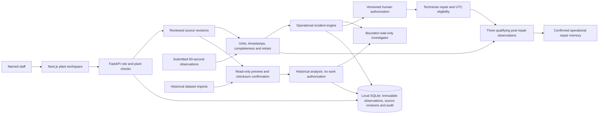
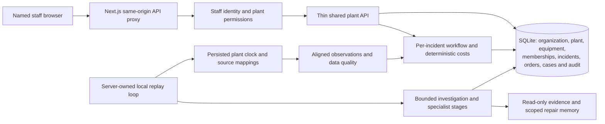
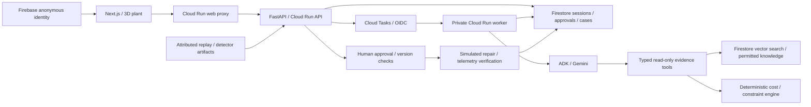

# Architecture and implementation boundaries

## Operational product and source foundation

The normal workspace requires staff identity and receives observations through versioned plant-scoped sources. It does not run replay clocks or generate asset readings. Equipment without usable current observations remains unknown. Historical files and legacy records cannot authorize current work or enter operational repair memory. See [telemetry source contract](telemetry-sources.md).

The API scheduler maintains investigation dispatch/leases; it never creates product measurements. UTC maintenance eligibility and observation freshness use server time. Source changes invalidate authorization and reset consecutive-window context. The existing dataset detectors are restricted to compatible historical features; operational diagnosis uses explicitly reviewed source envelopes. Current AI is scripted and clearly identified. These local changes do not complete managed cloud identity, distributed ingestion or live Gemini evaluation.

The sections below retain the implementation history and the isolated adapter's deployment architecture; replay behavior is enabled only through the explicit internal test setting.

The 9 October configuration milestone adds administrator-reviewed revisions, two-to-eight-line hydraulic templates, scalable scene bounds, configured production capacities, diagnostic replay bindings, and frozen historical incident topology. See [plant configuration](plant-configuration.md) for the contract, review steps, and supported limits.

The coordinated monitoring iteration adds a persisted plant clock, one reviewed source binding per asset, shared observation timestamps, explicit quality states, transactional incident ingestion and versioned evidence for investigation. See [monitoring](monitoring.md) for the data path and local boundaries. Independent diagnostic replay remains available when coordinated monitoring is disabled.

## Previous shared plant foundation

`/workspace` handles initial local setup, staff sign-in, invitations, permissions and audit review. The browser carries an eight-hour HttpOnly cookie; only its hash is stored. The API loads current membership for reads and rechecks it inside every human workflow write transaction. Shared approval requests contain option/version only; the server records actor ID and display name from the authenticated account.

An additive SQLite migration introduces organization, plant, plant-scoped area/asset/dependency catalogs, staff, membership, incident, order, verified case and audit tables. Equipment is seeded from the reviewed twelve-asset template; existing catalog records are not overwritten on restart. Asset editing and alternate layouts require a subsequent configuration contract. Private replay execution state is stored separately for each incident workflow; raw signals remain in replay files. Existing isolated demo records are retained separately and are not promoted into authenticated approvals.

Distinct assets can have concurrent incidents. Duplicate open sources on the same asset are rejected transactionally. Current plant status merges affected dependencies; output uses the minimum available capacity per affected line to avoid double-counting overlapping loss. Calculations cover one incident at a time, so simultaneous work-order scheduling still requires operator review.

Shared polling reads snapshots every two seconds; an API-owned scheduler advances replay even with no browser open. Local investigation leases and fencing remain authoritative. Detection committed before a dispatch interruption can be rediscovered; interrupted claimed execution can surface failure for review/retry. This local loop is not a durable production queue, and the shared cloud storage/identity adapter is not implemented. The shared access API fails closed in cloud mode.

Audit entries preserve actor, time, plant, incident and calculation version. Human transitions and their audit events commit together. SQLite triggers reject audit update/deletion through application SQL; database administrators and filesystem owners remain trusted. The UI's last forty events are a compact view; cursor-based audit history retains older entries.

## Existing cloud adapter for the isolated demo

For the isolated demo, SQLite replaces Firestore locally and FastAPI background tasks run the explicitly scripted investigator. Cloud Tasks dispatches the private worker in cloud mode. Shared local workflows additionally use the server scheduler described above. ADK's in-memory conversation is disposable execution state; workflow records remain persisted separately.

## Plant and replay

The dedicated `/plant` route has a procedural cutaway factory, orbit/close-up cameras, automatic/detailed/performance rendering, asset search and a 2D fallback. Repeated equipment geometry is instanced. Automatic quality detects slow rendering and switches to a reduced-resolution canvas without shadows; the equipment list and telemetry remain at normal browser resolution. `/operations`, `/incidents`, `/maintenance` and `/memory` share one session provider and serialized controller. Investigation, decision, work-order and memory panels are separate components.

The canonical plant has twelve asset IDs and typed dependencies. The scene uses IDs to select assets and highlight consequences; meshes are presentation only. Shared electricity and cooling relationships are represented without automatically stopping the parallel line for a single pump incident.

The server owns replay time. One measured cycle is 60 simulated seconds; one five-second wall interval advances a cycle (12×). The shared plant scheduler catches up bounded windows independently. The isolated demo uses POST `/advance`. A paused replay can be stepped explicitly. GET reads do not change the workflow.

UCI sensor matrices produce cycle means, standard deviations and 95th percentiles (27 features over nine signals). The persisted Isolation Forest and RobustScaler score each replay window at runtime. An incident requires three consecutive abnormal windows. Prepared files preserve cycle IDs, model parameters, attribution, split assignments, and transformations. Fault labels select scenarios but are not sent to the investigator.

Raw data stays outside source control. Deployment bundles small replay/model artifacts into the image, and the deployment guide archives them in private Cloud Storage. This is a prototype replay adapter, not a PLC/historian integration.

## Workflow and persistence

`detected → investigating → awaiting_approval → approved → repairing → verifying → resolved`

Explicit alternate states are `investigation_failed` and `proposal_rejected`. A rejected proposal can be reopened. A failed recovery remains `verifying` and never becomes a confirmed case. Reset changes the session generation so stale worker results cannot affect the new demo.

SQLite uses `BEGIN IMMEDIATE`; Firestore uses transactions. Worker claim leases prevent duplicate execution, and polling surfaces expired investigations. Retries retain an eight-model-call budget and a sixty-second investigation deadline. The task queue retries once; exhausted/expired investigation is shown as incomplete rather than substituting a scripted cloud diagnosis.

Each investigation attempt also owns a unique claim token. Old progress, completion or failure callbacks cannot overwrite a replacement claim or timed-out state. Queued jobs that do not start within ninety seconds become recoverable failures. Local SQLite uses WAL so readers can continue during serialized writes.

Public APIs validate Firebase identity in cloud mode and match the session owner. The worker endpoint exists only on the private worker service. Browser Firestore access is denied. Case retrieval is restricted to the current session; verified cases are prioritized directly, while shared procedure retrieval uses embeddings and vector search.

The app factory creates persistence at startup and supports an injected store for tests. HTTP dependencies, task dispatch, question answering and repair transitions are separate modules. Request bodies are bounded to 64 KiB; public input contracts reject unknown fields and blank required text. The frontend proxy checks write origins using the actual request host, limits body reads, and refuses backend redirects.

The client serializes polling and actions in `usePlantSession`, preserves approval retry keys for the same intent, and coalesces identity/session bootstrap requests. Question answers include inspectable source IDs. Local questions use deterministic current-session context; cloud questions require structured model output and citation validation.

## Decisions and trust

All cost calculations use integer paise over an eight-hour horizon. The model includes current degraded output, derated output, planned outage, repair expense, delivery penalties, and incremental failure exposure. Unique affected lines are derived from the dependency graph. Shared cooler faults include both lines; pump, motor and press-valve faults include their dependent line. Equipment repair expense is charged once. Failure probabilities are labelled assumptions, not calibrated model predictions.

The additional failure downtime is incremental to planned loss; remaining output caps further loss. Safety constraints precede cost ranking. A configured demo oil-temperature limit of 85°C forces the stop option. This is illustrative configuration, not a manufacturer limit or certified safety system.

Approval requires an exact calculation version and an idempotency key. Recalculation supersedes a work order and requires renewed approval. Agent tools cannot approve actions or write work orders.

### Incident workspace and authorization revisions

The dedicated Incidents route selects a persisted case through `?incident=<id>`. Archived or resolved cases are read-only. The page has separate investigation and intervention sections, with canonical dependency branches and a cost table from the backend. Evidence is normalized centrally from the saved investigation snapshot into a readonly `EvidenceView`; live telemetry never silently replaces cited readings. Original excerpts, document identity and provenance remain inspectable. Retrieved document JSON cannot classify itself as a measured signal record.

`decision_rules.py` checks the configured 85 °C demo limit on each replay window and before approval or repair start. The first breach is latched for the current incident, including its signal, timestamp, unit and provenance. Before execution it creates a new calculation revision and retires an existing work order as superseded. The original approval and calculation snapshot remain in the superseded-order history. Revision events preserve the old and new version IDs and the reason. Specialist positions retain the version they considered, so the UI labels them stale after a change.

A rejected stale command can still discover a new constraint. `persist_decision_transition` commits that constraint in the same ownership-checked transaction before returning HTTP 409; the client then reloads current state. Old idempotency receipts may be returned for exact retries but cannot reactivate a superseded order. The client verifies the current incident, order status and calculation version before presenting the Maintenance handoff, and Maintenance checks its incident deep link again.

The latch also sets affected-line capacity to zero in the simulated plant. Once a repair is being executed, its authorization snapshot stays immutable; a later breach records the constraint without rewriting executed work. Verification cannot count a window above the limit as healthy. Three healthy windows resolve the case and release the latch, while retaining the triggering evidence for review. These are demonstration workflow rules, not industrial control or manufacturer safety limits.

The `/evidence-preview` route runs only the evidence components with labelled synthetic fixtures. It disables session bootstrap and polling, supporting isolated component review without Python, data downloads or model credentials.

Diagnosis references are checked against returned evidence IDs. Generated currency claims are rejected. Documents and notes are untrusted evidence. Citation existence does not establish that a claim is scientifically correct; live-model grounding quality must be evaluated separately.

Repair completion stores the technician's correction, preserves the original hypothesis, and starts three-window recovery verification. Verified memory improves future retrieval context; no online model training is implemented.

## Equipment and independent agent stages

`profiles.py` owns reviewed equipment configuration, economic overrides and affected-line mapping. The IMS adapter keeps channel-one acceleration features in source units and preserves source record IDs. It uses an early-reference envelope and separate threshold windows; no independent-experiment predictive performance is claimed.

One active incident is permitted. Starting another scenario archives the resolved record, including evidence, approval and work order. Recurrence targets the most recently verified equipment. Reads of archived cases are ownership checked. Client actions carry `X-Incident-ID`, checked inside the same transaction as the transition; exact calculation versions still gate approval. Failed verification can return to the existing approved intervention, retaining earlier technician outcomes.

AI identity is independent of storage mode through `ai_client.py`. Live execution uses an ADK investigator with at most five calls, two independent specialist agents in parallel (one call each), and an evidence reviewer (one call). Both specialists receive identical computed options and facts; the Python cost engine ranks feasible actions. Output validation checks source IDs, role names, option feasibility and monetary claims. This is bounded orchestration, not open-ended autonomous negotiation.

Knowledge documents retain equipment-family metadata. Local retrieval filters equipment context before ranking. Cloud vector queries use an equipment-family equality prefilter and a matching composite vector index; reviewed shared documents are indexed for each applicable family. Verified cases remain session scoped and prioritized. Cloud index execution and model grounding still require live validation.
