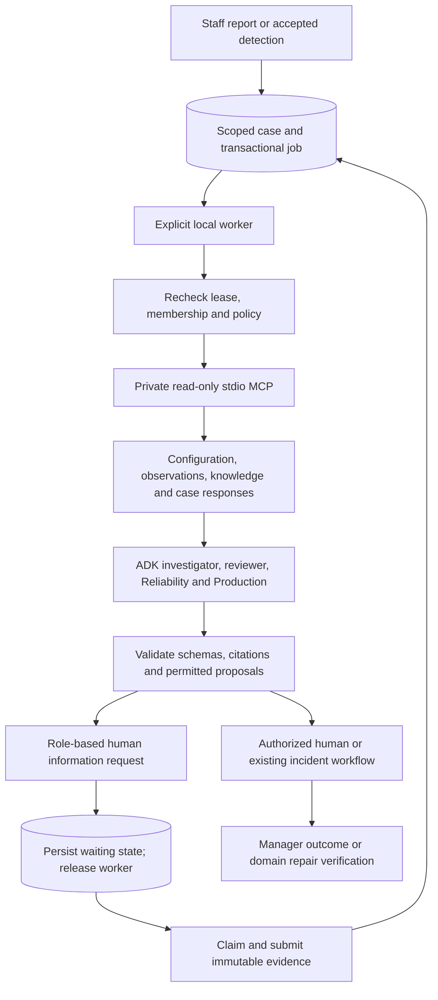

# Shared issue-management foundation

Implemented locally on 15 October 2026. Cloud deployment, managed identity and PostgreSQL adapters remain design work. The full-screen Plant and browser-generated Operators ledger retain their separate behavior. See [startup, recovery and rollback](../operations/cases.md) and [observed acceptance](../status.md).

## Records and authority

Migration 7 adds records without replacing migration 6, named staff, source observations, incidents, orders, calculations, approvals or confirmed repair memory.

| Record | Responsibility |
| --- | --- |
| Case | Scoped issue identity, category, evidence origin, linked incident, server phase, revision and analysis version |
| HumanTask | Requested evidence, reason, completion requirements, role, optional claimed owner and due time |
| EvidenceSubmission | Immutable authored report, typed reported values or manager outcome, with evidence references |
| AgentRun / AgentStep | Provider, initiator, policy version, stage inputs/checkpoints, validated advisory output and status |
| AutomationPolicy | Administrator-controlled, versioned permission for findings, information requests and overdue escalation |
| ProcessingJob | Stable run identity, queue state, lease, fencing token, attempt count and recovery checkpoint |
| Receipt / event / capability | Actor-bound idempotency, append-only history and short-lived worker authority |

Every stored record carries organization and plant scope directly or through a validated parent. Evidence and event rows reject ordinary updates/deletes. Technical checkpoints are replaceable only by the current worker claim; earlier analysis versions remain separate runs. Scope comes from staff membership or the server-minted worker capability, never model arguments. Public enrollment still bootstraps one organization; additional customer provisioning is not a new self-service UI in this slice.

Equipment reports can link to an existing accepted-observation incident for the same plant and asset. Several staff reports may refer to one incident. Linked phases follow the incident engine. Calculations, approval versions, repair recording and three qualifying verification windows remain authoritative. Backfill creates deterministic linked case identities for operational incidents only. It does not promote browser case ledgers or historical imports.

Production reports start with human assertions. A manager records the accountable outcome and selects supporting case evidence. This never creates confirmed repair memory. Equipment or maintenance reports cannot use generic resolution to bypass repair verification. Unsupported departments enter manual triage, without specialist automation.

## Coordination and recovery

The SQLite job row is the local transactional outbox. The worker polls it directly; no request-bound background task dispatches the new case workflow. Case transitions and job creation commit together. No transaction remains open during network/model execution.

Two attempts are allowed per run. Leases last 300 seconds and are renewed between stages. The context collector has a 30-second deadline; individual new specialist calls have a 45-second deadline. Live provider execution remains serialized to one active case job across local workers. Scripted capacity acceptance uses two workers. No concurrency or spending limit increases automatically.

Completed compatible checkpoints survive retries. Runs retain the execution fingerprint and model; a changed release/model blocks old checkpoints until an authorized new analysis revision. Policy snapshots, actors and timestamps remain in append-only history. New human evidence increments the analysis version and supersedes stale queued/running work. Material changes in a linked incident's calculation/source context also invalidate old analysis. Fenced workers cannot publish after replacement, revocation, policy changes or a newer version. Unknown provider usage is conservatively charged; case limits span revisions, organization ceilings span case runs, and existing global/user/incident limits remain enforced.

Human waiting requires no model session or leased worker. A valid response queues durable work under the current policy. A changed policy blocks older execution; an authorized analysis action creates a compatible revision. Due dates are optional. Only explicit overdue dates escalate, once, to the manager role. Time never approves work or completes a repair.

## MCP and model boundaries

One private MCP server exposes seven allowlisted tools: equipment context, recorded equipment issue history, equipment trends, production dependencies, scoped knowledge search, case evidence and saved deterministic comparisons. The coordinator collects these over the official MCP stdio transport. ADK specialists receive the collected evidence; they have no mutation tools. The authoritative linked-incident investigator retains its existing specialist/tool responsibilities and adds durable checkpoints.

The process launcher fixes executable, module and environment. A short-lived hashed capability binds run, plant, organization and lease. Each call rechecks membership and exact policy version. SQLite opens in read-only mode. Browser cookies and provider credentials are not passed to the child process. Model text cannot select commands, connection URLs, credentials or another tenant. These choices address local-server and scope boundaries described by the [MCP security guidance](https://modelcontextprotocol.io/docs/2025-11-25/tutorials/security/security_best_practices); they are not a claim of protocol-wide security certification.

Private repairs are scoped before retrieval. Reviewed shared references are returned separately. No cross-tenant retrieval cache is introduced. Captured tool inputs and stage checkpoints are run/plant scoped. Accepted observation values retain source version, time and quality; stale records remain explicitly stale. Staff values remain statements. Browser readings stay outside the authoritative case evidence stream. Monetary comparisons remain deterministic and versioned; models do not generate the amounts.

Equipment history captures a server-timed 30-day window for the selected asset. Counts include recorded equipment cases, including the current case; multiple cases linked to one incident count once. Cancelled cases, future records, other categories, other plants and browser-generated ledgers do not contribute. Up to ten recent case summaries accompany the exact count. History remains frozen inside the saved analysis context across retries. A pattern is a prompt for investigation, not a verified common cause or a failure-rate estimate. Verified repairs remain a separate retrieval source.

The notification feed projects committed cases and tasks rather than generating notification prose with a model. Human requests follow role/ownership; review-ready and blocked cases reach reviewers or their reporting actor. Reviewers also receive one recurrence item per asset with at least three equipment cases in 30 days and an open case. Read acknowledgements use a reserved actor/organization/plant-scoped receipt namespace, without altering tasks, approvals, jobs or repairs. Closed/superseded work leaves the actionable feed. Current completed investigator summaries can appear as explicitly labelled saved AI assessments. No additional model calls or notification service is required.

Only server code applies permitted coordination proposals. Policies cannot grant intervention approval, spending authority, physical work, equipment control or repair verification. Default policies are disabled. Gates require fresh matching investigation, assistant and four-case live reports before new live automation can execute. A failed model or gate leaves manual cases/tasks and the existing deterministic workflow available.

## Production target and migration

Next.js and FastAPI run on Cloud Run. Private workers scale independently, with configured concurrency and organization budgets. Cloud Tasks delivers only a database job identity through authenticated service requests. Duplicate or unordered delivery is expected; PostgreSQL claims, fencing and versions remain the correctness boundary. See [Cloud Tasks delivery limitations](https://docs.cloud.google.com/tasks/docs/common-pitfalls) and [Cloud Run service identity](https://docs.cloud.google.com/run/docs/authenticating/service-to-service).

Cloud SQL PostgreSQL holds operational state. Cloud Storage holds versioned objects, addressed through tenant-scoped metadata and server authorization. Object paths, retrieval filters, caches and signed access require organization/plant scope. Reviewed shared references have explicit provenance and visibility. Managed identity maps to stable internal staff IDs without replacing historical actors. PostgreSQL row policies supplement service authorization. This supersedes the provisional shared Firestore target; the old isolated-demo adapter remains historical code.

Before a future database transition: freeze writes during a bounded cutover, back up SQLite using its backup API, import stable IDs and integer-paise values into a staging PostgreSQL schema, verify row counts/references/audit/evidence hashes and run tenant/concurrency tests. Rehearse restore and rollback against an isolated copy. Cut over only after acceptance; retain the original read-only backup and a reconciliation manifest. Do not dual-write approvals speculatively. No such migration, provisioning or identity cutover occurs in this phase.

## Deliberate limits

The local implementation uses SQLite and inline text/typed values; file evidence upload and managed object storage are future adapters. Case and inbox lists paginate. Detail reads show 50 recent tasks, 50 evidence records, 10 runs and 100 events; older rows remain stored but historical subresource pagination/export is not yet exposed. Task reassignment/release and commercial tenant onboarding remain follow-up work. No PLC/historian connector, autonomous physical action, inventory feed or general industrial diagnostic accuracy is claimed.
