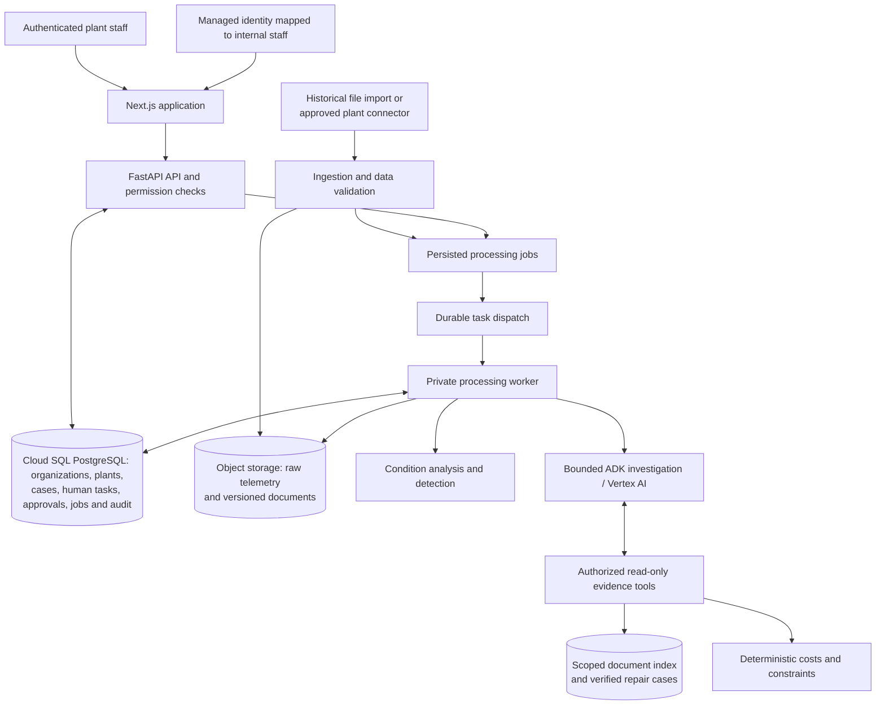

# PlantSense production architecture proposal

Status: production target updated on 15 October 2026. Local case coordination now uses SQLite and a separate worker; the production services below are design only. Development remains local. The [case foundation](case-foundation.md) describes implemented records, coordination boundaries, acceptance and the planned SQLite-to-PostgreSQL transition.

The shared local foundation was implemented on 8–9 October: plant-scoped catalogs, named staff/memberships, authenticated approval actors, concurrent per-incident workflows and retained audit. See [implemented scope and review](../history/shared-plant-review.md) and [observed validation](../status.md). The findings below describe the earlier baseline that motivated the target; managed cloud identity, real ingestion, durable production dispatch and launch operations remain outstanding.

The 9 October configuration milestone adds administrator-reviewed revisions, two-to-eight-line hydraulic templates, scalable scene bounds, configured production capacities, diagnostic replay bindings, and frozen historical incident topology. See [plant configuration](../product/plant-configuration.md). A synchronized ingestion clock, data quality processing, live AI evaluation, managed cloud identity, and durable production workers remain subsequent milestones.

## Product boundary

PlantSense is a maintenance decision application. It helps authorized staff inspect equipment condition, investigate evidence, compare interventions, approve work and verify the result. The first release should cover a bounded set of equipment and a defined group of plant staff.

Plant configuration, incident history and repair knowledge belong to the organization and plant. Browser sessions identify users; they must not own separate copies of the operational plant. Several authorized staff must be able to work on the same plant, with several incidents active concurrently.

The application records maintenance decisions. Direct equipment actuation requires a separately designed and reviewed integration. Plant procedures, permissible operating limits and emergency response remain site-owned inputs.

## Findings in the existing implementation

| Finding | Repository evidence | Required change |
| --- | --- | --- |
| Plant state is owned by a browser identity | `store.py`, `engine.fresh`, session API routes | Organization and plant records shared by authorized members |
| Production permissions are absent | `dependencies.py` checks session ownership | Authenticated users, plant memberships and server-enforced permissions |
| Approval identity is user-entered text | `ApprovalRequest.approver`, approval transition | Derive the accountable actor from verified identity; retain display name as a snapshot |
| Persistence rewrites a growing session aggregate | SQLite JSON and Firestore session document in `store.py` | Separate entity records, bounded read models, pagination and explicit schema versions |
| History is deliberately truncated | `events.py` keeps 40 events; `engine.py` keeps 20 historical incidents | Durable audit and incident retention policy with no silent truncation |
| One incident is active at a time | Current session engine and scenario transitions | Independent incident identities and concurrency checks per incident and asset |
| Telemetry progresses through client-triggered replay | `/advance`, `/replay`, `engine.advance` | Independent ingestion and processing; browser reads must not drive plant monitoring |
| Local jobs run inside the API process | `dispatch.py` uses FastAPI background tasks | Durable jobs, retry state, restart recovery and reconciliation |
| Recovery can be selected through a demo control | `RepairRequest.recovery` and replay selection | Verify against actual post-repair measurements and reviewed acceptance criteria |
| Economics and operating limits are demo configuration | `economics.py`, `profiles.py`, `decision_rules.py` | Site-reviewed, versioned inputs with explicit provenance and validity |
| Live AI and vector retrieval lack live acceptance evidence | `docs/status.md`, `docs/engineering/evaluation.md` | Grounding evaluation, failure testing and staged operator review |
| Operational launch controls are incomplete | Current deployment scripts and health checks | Monitoring, backup restore, runbooks, staging, release rollback and capacity checks |

Existing typed contracts, integer-paise calculations, approval version checks, idempotency, worker fencing, evidence provenance and modular boundaries are useful foundations. Their current tests establish the prototype behavior, not launch readiness.

## Proposed deployment shape

Keep one modular Python codebase, deployed as API and worker roles. Keep Next.js as the interface and server proxy. **Cloud SQL PostgreSQL supersedes the earlier provisional Firestore target for shared operational state.** Existing isolated-demo Firestore adapters are historical compatibility code, not the deployment path for customer case management. Store large telemetry and versioned evidence objects in Cloud Storage.

On Google Cloud, use Cloud Run for the web, API and independently scaled private workers; Cloud Tasks for bounded delivery; Cloud Storage for objects; Cloud SQL PostgreSQL for operational records; and Vertex AI for models. Persist job identity, budgets and checkpoints in PostgreSQL even when Cloud Tasks delivers work. Select a tenant-scoped retrieval index and live-stream transport only after query patterns and source requirements are established.

The ingestion box is a logical module. It does not imply another independently deployed service for the first release.

## Domain and access model

Core records:

- Organization, Plant, Area, Asset, SignalDefinition and Dependency.
- User, Membership and Permission.
- DataSource, ImportJob, MeasurementReference and DataQualityResult.
- Incident, InvestigationRun, EvidenceSnapshot and CalculationRevision.
- Approval, WorkOrder, RepairAttempt and VerificationRun.
- DocumentVersion, KnowledgeChunk and VerifiedRepairCase.
- AuditEvent, ProcessingJob and UsageLedger.

Every plant-owned record carries organization and plant scope. The API derives effective access from verified identity and active membership, and validates that linked records share the correct scope. Caller-provided organization IDs, role labels or approver names never establish authority.

Initial permissions should cover viewing, investigating, maintaining configuration, approving interventions and recording repair work. Exact role names and separation of duties are set with the first plant. Membership revocation must affect protected actions promptly; UI visibility is only presentation.

Approve an incident using its current calculation version, a stable idempotency key and a verified authorized actor. Concurrent edits return an explicit conflict. Historical authorization snapshots remain inspectable. Audit events include actor, entity, action, time, request ID, revision and reason; ordinary application actions cannot edit or silently discard them.

Service authorization remains mandatory. Add PostgreSQL row policies as defense in depth, using a non-owner application role without `BYPASSRLS` and transaction-local organization/plant context. Connection-pool reuse must clear scope. Table owners and privileged roles can bypass row security, so row policies do not replace service checks. Use explicit migration and index versions. [PostgreSQL row-security behavior](https://www.postgresql.org/docs/current/ddl-rowsecurity.html).

## Data ingestion and verification

For historical files, first define a documented import contract: asset mapping, signal ID, measurement time, unit, numeric value and source metadata. Implement bounded parsing, unit compatibility, duplicate detection, ordering, missing-data handling and an import report. Do not load uploaded model pickle files.

For a live source, establish the approved gateway or historian interface, credentials, sampling rates and network boundary first. The connector reports source health and resumes using a persisted checkpoint. Retain both source timestamps and receipt timestamps.

The processor must run without an open browser. Late, missing, stale or contradictory measurements produce explicit data-quality states. They must not silently count as healthy equipment or support confident diagnosis. Configurable retention and downsampling keep raw telemetry separate from compact evidence and current-state summaries.

Commission detection for the supported assets against representative operating modes. The present UCI/IMS replay models are development examples and cannot establish a site's operational false-alarm rate or failure probabilities.

A verification policy identifies the measurements, operating conditions, observation duration and acceptance limits required after a repair. The technician supplies observations; the verification service evaluates actual subsequent measurements. Insufficient measurements leave the outcome unverified. Retain the AI diagnosis, technician correction, policy version and verification evidence.

Production mode must report unavailable data explicitly. Demo replay, synthetic fallback and reset controls remain in a clearly separated development/demo context.

## Durable processing

Persist a job or outbox record in the same transaction that records the domain change requiring work. A dispatcher enqueues it outside the transaction, using a stable job identity. A reconciler recovers committed jobs that were not successfully dispatched.

Workers claim jobs using leases and fencing tokens, checkpoint progress and record terminal outcomes. Duplicate delivery must be harmless. Retries retain the original budget and record failure reasons; exhausted jobs remain visible and can be reviewed or retried by an authorized operator. Do not rely on queue order for entity correctness.

Separate ingestion processing from paid investigation execution. Concurrency, timeout and rate limits are configured independently. Independent incidents should not block one another, while revisions of the same entity require conflict handling.

## AI responsibilities and evaluation

Keep the existing bounded investigator, Reliability/Production perspectives and evidence review stages. Each stage uses a versioned evidence snapshot. Tools authorize plant scope and return typed facts, source references, versions and timestamps. Shared reviewed references and private plant documents have explicit visibility rules; filtering occurs before retrieval results reach the model.

The cost engine owns monetary values and feasibility. Failure exposure is unavailable or clearly assumption-based until an approved probability source exists. AI provides hypotheses, limitations and operational explanations. It cannot modify permissions, approve interventions or create executable work orders.

Validate schemas, citations, permitted tool calls and option references. Assess claim support with a reviewed evaluation set; a second model review alone does not establish correctness. Preserve useful completed stage results when another stage fails. Record model, prompt, tool and document versions, latency and actual token usage without hidden reasoning or credentials.

Test ambiguous signals, missing sources, stale readings, contradictory procedures, instructions embedded in documents, partial specialist failure, timeout, quota exhaustion and dependency outages. Define thresholds and human review requirements before enabling recommendations for the first plant. Maintain a controlled model/prompt rollback and regression gate.

## Operations and release gates

Before launch:

- Separate development, staging and production configuration and data. Use reproducible infrastructure configuration and versioned immutable images.
- Use TLS, workload service identities, least-privilege IAM, managed secrets and authenticated private worker requests. Enforce endpoint and ingestion quotas.
- Monitor API failures/latency, source freshness, job backlog, retry/lease failures, investigation latency, AI usage and cost, and approval conflicts. Redact sensitive data in logs and exports.
- Define service availability and data-freshness targets, recovery point/time objectives, retention and support ownership with the first plant.
- Execute a backup restoration into an isolated environment and verify incidents, approvals, audit and evidence references.
- Test worker/API restarts, concurrent operators, multiple incidents, duplicate and delayed tasks, membership removal, cross-plant access and stale authorizations.
- Complete load tests for the agreed user count and sampling rates, accessibility checks and end-to-end acceptance on staging.
- Document incident response, data-source outage, AI outage, recovery, release rollback and data migration procedures.

The earlier INR 5,000 budget remains a planning constraint until changed. Estimate costs from the first plant's data rate, retention, user count and AI usage before provisioning. Budget notifications supplement application limits; they do not themselves stop spending.

## Implementation order

1. **Shared plant foundation:** scoped domain records, memberships, authenticated actor attribution, permissions, durable audit and migration strategy. Acceptance: two authorized users see the same plant; an unauthorized user cannot read it or approve work; history survives refresh and restart.
2. **Real data path:** implement the selected import/connector, data-quality reporting and independent processing. Acceptance: uploaded or connected measurements retain identity/units/provenance, and missing or stale data cannot appear healthy.
3. **Reliable incident processing:** multiple incidents, durable jobs, reconciliation, deterministic decisions and approved work-order flow. Acceptance: crash and duplicate-delivery tests preserve one valid authorization and a complete audit.
4. **Live AI and knowledge:** scoped retrieval, bounded stages, partial failure behavior and grounding evaluation. Acceptance: reviewed live outputs meet agreed quality limits while deterministic workflow remains available during AI outages.
5. **Launch operations and UX:** production workspaces, onboarding/configuration, monitoring, restore/rollback exercises and operator acceptance.

The user clarified on 9 October that no hardware is available. The immediate telemetry source is dataset replay plus generated plant signals, delivered through the same validated ingestion boundary intended for later connectors. UCI hydraulics and IMS bearings are already prepared locally; supporting plant context is synthetic. Replay sequencing, acceleration, interpolated/altered signals and repair recovery remain explicitly labelled simulation. The next milestone should coordinate the whole plant's time and dependencies, retain provenance and exercise missing/stale/contradictory data. Actual PLC/historian integration and first-customer commissioning remain later work. Cloud deployment remains deferred.

## Primary references consulted

- [Firebase access control with custom claims](https://firebase.google.com/docs/auth/admin/custom-claims): roles require validated identity and server enforcement; claims do not replace membership data.
- [Firestore best practices](https://firebase.google.com/docs/firestore/best-practices) and [limits](https://firebase.google.com/docs/firestore/quotas): document growth, indexes and contention inform record boundaries and load testing.
- [Cloud Tasks execution limitations](https://docs.cloud.google.com/tasks/docs/common-pitfalls): duplicate execution and unordered dispatch require idempotent, version-aware workers.
- [Cloud Run service authentication](https://docs.cloud.google.com/run/docs/authenticating/service-to-service): service identities and IAM protect private worker invocation.
