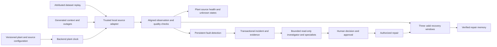

# Coordinated plant monitoring

**Implementation history:** the replay controls described below have been removed from the normal product. Use [plant observations and historical imports](telemetry-sources.md) for the current Monitor workspace. The adapter remains only for internal automated regression tests.

This local iteration connects configured equipment to a single backend replay clock. No PLC hardware is required. Hydraulic and bearing features come from the prepared, attributed datasets when available; other signals and replay failures are generated examples. Reused test-rig records do not establish independent measurements from multiple plant assets.

## Use it

1. Open `http://127.0.0.1:3000/workspace` and sign in with the staff account created during setup. There is no default password. Open your plant, then **Monitor**.
2. Review the source assigned to each configured asset. Equipment with pump, cooler, valve or bearing profiles supports fault replay. Other equipment supplies contextual signals.
3. Select **Degradation after 3 windows** for one diagnostic asset and **Enable plant monitoring**. Saving source mappings pauses the clock.
4. Select **Advance plant window** six times, or run the clock. Three consecutive valid abnormal observations create an incident and dispatch investigation automatically. Open the source's incident evidence.
5. Compare interventions and approve an option. **Stop & repair now** can start immediately. Deferred actions wait for their approved tick on the shared clock; they do not advance another asset's clock independently.
6. Record the technician outcome, return to Monitor and advance three healthy windows. Missing, stale, conflicting or abnormal observations prevent verified recovery and confirmed memory.

Select missing, stale or conflicting data to inspect explicit uncertainty. Unapplied source changes block clock controls. After saving changed mappings, authorization remains blocked until a new valid observation arrives. Historical evidence remains retained.

Resolve active incidents before changing their fault mapping or disabling monitoring. Pause and disable monitoring before changing the plant layout. Independent scenario controls remain available when coordinated monitoring is disabled.

## Boundary and ownership

- Each tick represents one simulated minute; running advances every five wall-clock seconds. Observation timestamps share one persisted replay origin. Receipt times record actual adapter execution. These timestamps do not represent dataset acquisition times.
- Clock, source checkpoints, incident projections and compact evidence commit together in a SQLite transaction. Repeated clock commands reuse an idempotency receipt, with a bounded 128-command receipt history; stale ticks and source versions are rejected.
- Read-only polling does not advance time. The local API scheduler runs without an open browser. Restart resumes the persisted clock, processing at most twelve overdue ticks per scheduler pass.
- Admins configure sources. Plant managers control the clock. Existing staff role, plant ownership, approval and technician permissions remain authoritative in server transactions.
- Mapping revisions and workflow audit records are append-only. A source creates one incident per replayed event. After verified resolution, change the mapping to healthy and then degradation to demonstrate another event and retrieve repair memory.
- Automatic monitoring allows three investigation dispatches per plant per UTC day, independent of mapping edits. Additional incidents retain evidence with an explicit investigation failure. Existing global AI call limits and investigator turn/time bounds remain in force.
- Retrieval reserves procedure context when repair memory grows. The local evidence pack includes up to three verified cases and at least two reference slots; cloud retrieval reserves up to four document slots alongside two verified cases. The scripted path cites returned sources only and keeps missing-procedure failures explicit.

## Quality and interpretation

| State | Interpretation | Detection / verification |
| --- | --- | --- |
| Fresh | Aligned, valid replay observation | May count toward the persistent-window rules |
| Missing | No observation | Excluded; condition unknown |
| Stale | Configured old observation or running source stopped updating for over 15 seconds | Excluded; authorization blocked |
| Conflicting | Configured inconsistent reading; overridden values labelled synthetic | Excluded; condition unknown |
| Not started | No current observation after configuration | Excluded; condition unknown |

Paused replay shows the last recorded observation as a paused snapshot. It is not a live freshness guarantee. Received and observed timestamps remain available in the API; source cards show replay observation time. Quality does not overwrite an existing critical/stopped incident status; a separate source state explains uncertainty. Otherwise invalid data changes healthy equipment to unknown.

Production quantities remain configured estimates. The same backend rates supply the plant overview and synthetic press/finished-goods output displays. Missing data never establishes that production or equipment is healthy. Original measured values, units and dataset record IDs remain available with their provenance.

## Current limits

The coordinated adapter is local, with one API service and SQLite. Distributed ingestion, durable cloud dispatch, PLC connectors, automatic source discovery and joint maintenance scheduling are later deployment gates. Supporting context is not a physical plant solver. Invalid observations create data-quality states rather than an equipment fault diagnosis. Docker uses the scripted investigator; live Gemini quality, latency and token costs remain unverified.
