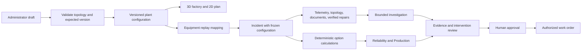

# Configurable hydraulic plant

## Review locally

1. Open the shared plant through `/workspace` and sign in as its administrator.
2. Select **Setup**, then **Load plant configuration**.
3. Preview the eight-line hydraulic template: 36 assets, ten areas, and 800 nominal parts/hour.
4. Review equipment names, positions, rated line capacities, diagnostic bindings, and dependencies. Previewing never changes the saved plant.
5. Select **Apply configuration**. Open telemetry sources and unresolved incidents must be completed first. Stale drafts must be reloaded.
6. Open **Plant**. Camera presets and both scene modes use the configured layout. Select a diagnostic scenario and its compatible equipment through **Telemetry equipment**.

Existing installations retain their two-line configuration until an administrator applies a change. Template previews are available for two through eight lines. The editor offers two, four, six, and eight lines; advanced JSON supports a bounded custom hydraulic layout.

## Configuration contract

`PlantConfiguration` contains the plant name, areas, equipment, and directed dependencies. IDs are canonical and unique. Areas with positive rated output contain exactly one hydraulic press; each press must have a downstream path to a finished-goods station. A diagnostic binding must match a supported equipment type. Equipment sits at floor level within 150 metres of the origin. Maximums are 20 areas, 100 assets, and 400 edges; the API also enforces its 64 KiB request limit.

The supported geometry types are pump, motor, press, conveyor, cooling, compressor, electrical, and goods. This is a hydraulic manufacturing configuration, with four reviewed diagnostic profiles. It is not a universal industrial process editor.

| Interface | Purpose |
| --- | --- |
| `GET /api/v1/plants/{id}/configuration` | Read the current configuration and revision |
| `POST /api/v1/plants/{id}/configuration/template` | Preview a reviewed template |
| `POST /api/v1/plants/{id}/configuration/validate` | Validate and normalize an advanced JSON draft |
| `POST /api/v1/plants/{id}/configuration` | Activate an administrator's draft with `expected_version` |
| `POST /api/v1/plants/{id}/scenarios` | Bind a compatible diagnostic replay to `asset_id` |

Activation and source creation use the same SQLite write transaction boundary. This prevents a source from starting against a partially updated plant. Configuration history is append-only; successful activation writes a named actor to the durable audit. Equipment referenced by historical workflows retains its ID and type. Invalid graphs, unsupported bindings, stale revisions, unauthorized actors, and open workflows cannot change the saved configuration.

Each new workflow freezes the plant configuration and its version. Investigation impact evidence cites that version and includes actual dependency branches, affected equipment, and configured line capacities. Historical diagnoses and approved calculation snapshots remain traceable.

The local scheduler writes only when a new replay window is due or an investigation deadline needs handling. Verified workflows close their diagnostic replay; replay controls cannot mutate a resolved historical case. A new source or verified recurrence starts a fresh workflow. This keeps completed case playback from consuming ongoing background writes.

## Capacity and data assumptions

Production output is the sum of configured line capacities. Each active incident restricts its affected lines using its reviewed degraded/derated percentage. For overlapping incidents, each line uses the lowest resulting capacity; losses are counted once. Rounded per-line outputs are retained explicitly rather than reconstructed from total plant output.

The cost engine scales production loss and delivery targets to the configured affected capacity. Production quantities use half-up integer rounding; the comparison and investigator use the same saved delivery target. The assumptions panel distinguishes rated capacities, percentage restrictions, reference scaling, and the total affected delivery commitment. Equipment repair expense is charged once per incident, and currency remains integer paise. The eight-hour horizon, risk assumptions, durations, and contribution margin remain synthetic operational assumptions. The comparison handles each incident separately; it does not optimize a joint repair schedule or resource contention.

Dependencies currently determine reachability and affected production lines. Incident views expand each downstream equipment path once and label repeated paths, keeping converging custom graphs readable and bounded. `capacity_fraction` is retained as configuration metadata; it is not a general fractional flow solver. Supporting signals are labelled synthetic. Diagnostic source mapping preserves the original dataset record IDs, values, units, and measured/synthetic provenance. Reusing a replay for multiple pumps does not create independent measured equipment data. Simulated source workflows still have individual replay windows; a synchronized whole-plant ingestion clock is subsequent work.

## AI scope

The existing bounded workflow uses telemetry, the frozen dependency graph, relevant documents, verified repairs, and the same computed cost table for Reliability and Production. Its tools are read-only. AI cannot activate configurations, approve actions, or write work orders. Unsupported equipment receives context telemetry rather than an invented diagnosis.

The default Docker configuration still uses the explicitly labelled scripted investigator. Gemini/ADK support is wired, but live model access, grounding evaluation, and cloud retrieval remain unverified. This change expands the context passed to that workflow; it does not claim a live model connection, trained diagnosis for every asset, or industrial prediction accuracy. Shared free-form plant questions remain disabled pending their own bounded access and evaluation milestone.
